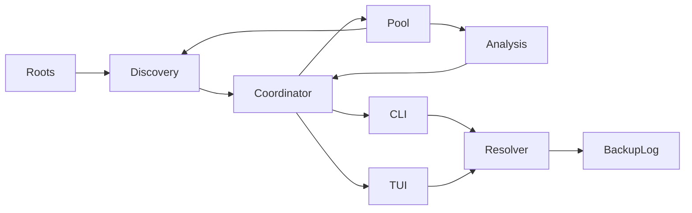

# Goals

### Direction
A complete Rust replacement, including a Rust TUI, is feasible and a good learning project. Prioritize reliability, then speed, while preserving or improving UX. Deliver incrementally with behavioral parity; preserve existing commands and outcomes rather than exact visual formatting. Benchmarking is supporting evidence, not a primary goal; avoid assuming speed gains.

### Compatibility and safety
Preserve conflict patterns and custom configuration, CLI and interactive workflows, media metadata and external tools, cache and decision-log behavior, and backup-first resolution. Keep user data safe, including on failures; dry-run must not write anywhere. Record existing discrepancies as explicit compatibility decisions rather than silently reproducing bugs.

### Scope
Implement the migration in the delivery order below. Keep the Python implementation as a reference until parity is established; do not modify sample data. Do not create a branch unless requested.

# Technical Design

### Existing baseline
`scan.py` walks roots serially and groups sorted paths; `engine.py` coordinates cache, analysis and resolution; `analyze.py` hashes and compares files; `resolve.py` backs up losers and logs decisions. `cli.py` and `tui/app.py` are separate frontends; `media.py`, `patterns.py`, `config.py`, and `launchers.py` contain substantial compatibility requirements. The referenced `.opencode/plans/2026-08-30-deconflict.md` is absent in this checkout.

### Rust architecture
Build a UI-free core with explicit discovery, grouping, analysis, cache, resolution and tool-launching boundaries, plus CLI and TUI frontends. Consider `clap` for CLI and `ratatui` with `crossterm` for TUI; validate dependency and platform fit before committing. Keep existing TOML and JSONL formats compatible, including regex features supported by existing custom patterns; investigate Python/Rust regex differences rather than assuming equivalence.

Ship the core as a Rust library consumed by a separate Rust CLI. Support the custom regex features needed in practice rather than blocking on complete Python regex parity; test Windows later. CLI progress should distinguish provisional findings from final results, keep machine-readable output usable, and never permit resolution after an incomplete scan.

Discovery feeds an in-memory coordinator; grouping and provisional analysis overlap further discovery. Use one shared worker pool for directory and analysis tasks, favoring analysis with fairness so discovery cannot starve. Finalize groups only once all relevant discovery is complete, including overlapping roots and symlink handling; provisional UI results cannot authorize destructive operations. Revalidate file identity and metadata before resolution, and serialize mutations and decision logging.

Expose documented configuration and CLI overrides for worker count, with conservative defaults and a one-worker mode. Respect existing `nice`/`ionice` inheritance on Linux; document external usage and portability rather than promising platform-independent I/O priority. Resource limits do not guarantee low CPU, memory, or disk impact; evaluate optional throttling only against measured need.

### Scheduling decision
Keep all pending directory and analysis tasks in memory without queue capacity limits; prioritize execution rather than delaying discovery to limit backlog. Do not reopen and rescan directories to control memory. Limit concurrent workers and open directory handles; memory grows with the number of tasks and results, assumed manageable for intended workloads. Measure performance rather than assuming an ideal priority policy.

### Risks
Filesystem changes during scanning, missing files, duplicate roots, ordering, case sensitivity, symlinks, errors and cache invalidation require explicit semantics. Maintain deterministic final ordering despite concurrency. Media parity, terminal behavior and Windows support may be harder than the core port. The current `Engine.scan()` refreshes cache even when dry-run is configured; verify and document this discrepancy against the stated no-write requirement.

# Validation

### Shared executable contract
Extend the existing `pytest` infrastructure with subprocess-based black-box tests parameterized by executable command: run against Python first, then the Rust binary. Use isolated temporary homes, config, cache, backup directories and copied fixtures; normalize paths and nondeterministic timestamps, while asserting exit codes, meaningful output and filesystem/log effects. Keep existing Typer-specific unit tests separately. Use PTY-based tests for representative interactive CLI/TUI flows; subprocess tests alone cannot establish TUI parity.

### Coverage and performance
Cover patterns/custom regex, grouping, multiple copies, missing bases, config, auto rules, dry-run no-write guarantees, backup/restore safety, decision logs, media/tool fallbacks and errors. Test one and multiple workers, randomized completion order, cancellation, overlapping roots, symlinks, permissions and files changing mid-scan. Use reproducible benchmarks when useful to assess performance, documenting workload and limitations; avoid hard speed claims or brittle CI timing thresholds.

# Delivery Steps

### ✓ Step 1: Establish behavioral and performance baselines
The Python implementation has an executable-level compatibility baseline.
- Inventory CLI, TUI, configuration, media, safety and platform behavior using existing tests and documentation.
- Add isolated subprocess-based `pytest` contract cases for Python, including dry-run and backup/log effects; record discrepancies without silently changing requirements.
- Define reproducible benchmark datasets and collect baseline measurements.

### ✓ Step 2: Build streaming Rust core
A UI-free Rust core discovers, groups and compares conflicts with bounded concurrency.
- Port patterns, configuration, traversal, grouping, hashing and analysis from the corresponding Python modules.
- Implement the shared fair scheduler, in-memory queues, provisional results and final grouping barrier with worker controls.
- Test deterministic output, concurrency limits, filesystem races and existing custom-pattern compatibility; use benchmarks where useful.

Status: 48 Rust tests pass; cancellation and disappearing-base errors are covered. ASCII regex support remains partial, Windows behavior unverified, and filesystem snapshots are not atomic. Media and mutation-time revalidation are deferred to step 3.

### ! Step 3: Port safe resolution and integrations — complete for core parity
The Rust core preserves resolution, cache and external-tool behavior safely.
- Port backup-first actions, dry-run, JSONL logging, cache, media metadata and tool discovery with compatible formats.
- Revalidate before changes and serialize filesystem mutations; handle cross-device moves and failures safely.
- Extend contract and fault-path tests against both executables.

Status: 61 Rust library tests pass. The 61-test library suite is green after the current cache/media API changes. Cancellation and disappearing-base errors are covered. ASCII regex support remains partial, Windows behavior unverified, and filesystem snapshots are not atomic. Media and cache APIs are implemented, but final CLI behavior and executable contracts still need validation.

**Current progress:**
- `resolve.rs` is exported as `deconflict_core::resolve`.
- Resolver unit and integration coverage includes dry-run, backup/log behavior, partial failures, symlinks, missing-scan rejection and changed-file rejection.
- Cache JSON loading, saving, keying, cleaning and dry-run protection are implemented in `cache.rs`.
- Added cache-aware and media-aware Rust group-analysis entry points in `analysis.rs`.
- `media.rs` now has a translated tool structure and content/metadata extraction APIs available to group analysis.
- Rust CLI scan/resolve code now passes cache and media configuration into analysis; `--no-cache` and `--refresh` surfaces are present.
- The release executable build started; shared executable-contract validation was not completed before stopping for today.

**Remaining Step 3 work:**
1. Validate cache reuse, refresh, no-cache and dry-run behavior against existing JSON/cache fixtures and executable contracts.
2. Correct/cache-test any media fields, kind detection or recommendation regressions found by contracts.
3. Persist/invalidate scan cache according to real resolve and dry-run semantics only after successful validation.
4. Close cross-device, recovery and interprocess-race gaps with fault-path tests.
5. Preserve JSONL and backup formats explicitly, documenting intentional compatibility decisions.

**CLI milestone completed:**
- Added a `clap`-based Rust executable named `deconflict` with `version`, `patterns`, `scan`, `resolve`, `init-config`, `setup`, `config` and `cache clean` surfaces.
- `scan`, `resolve --dry-run`, real resolution and backup decisions previously passed shared executable contracts.
- Fixed CLI pattern-name output and Python-compatible backup subdirectories/filenames.

**Verified next-step sequence:**
1. Finish cache/media wiring and run Rust plus shared executable contracts.
2. Close interprocess-race, cross-device and recovery gaps, then add executable-level resolution contracts.
3. Add real progress and bare interactive behavior, then the Ratatui TUI and PTY coverage.
4. Keep Python as the reference until Rust contracts pass; do not switch packaging or require Rust for existing users.

###   Step 4: Finish CLI parity — in progress

**CLI parity status:**
- Restored the Rust CLI build and implemented setup/config/cache handlers.
- Root `--version`, root/bare command parsing, and scan/resolve option surfaces compile.
- Cache/media analysis entry points compile with the Rust library suite.
- `--no-cache` and `--refresh` are wired and have executable contract coverage.
- Real scan progress and a skipable bare CLI fallback are implemented.
- Rust interactive resolve reports per-group metadata, text differences, consideration notes and recommendations, then accepts the recommendation on Enter or base/copy/keep-both/skip/quit actions.
- Generic Rust metadata reports format created and modified timestamps separately, using Unix change time as the creation-time fallback.
- ExifTool metadata is parsed from JSON so MP3 fields and ID3 tags render with their real names and values. Tables highlight differences, newer/larger values, and recommendations with terminal-aware styling that is disabled for piped output or `NO_COLOR`.
- `--auto` remains noninteractive; `--tui` clearly reports that the TUI is not implemented.
- A copied `sample-files/` fixture smoke test found 9 conflict groups successfully.

**CLI completion sequence:**
1. ✓ Finish cache/media wiring and shared Python-vs-Rust executable contracts.
2. ✓ Fix contract failures and close executable-level resolution, dry-run and backup/log gaps.
3. ✓ Implement real CLI progress and bare interactive behavior; validate PTY flows where practical.
4. ✓ Run the full Rust suite, shared contracts and benchmark smoke checks.
5. ✓ Add CLI analysis-report parity and its executable contracts; commit the CLI milestone before further TUI work.

**Stable CLI gate:**
- A release build starts successfully on the target machine.
- Cache, refresh, no-cache and dry-run contracts pass for Python and Rust.
- Resolution, backup, JSONL and failure/recovery contracts pass.
- Existing CLI commands retain compatible options, exit codes and meaningful output.
- CLI resolution reports file metadata, content differences, considerations, recommendations, and interactive choices consistently with the Python CLI.
- Bare CLI behavior is usable, and `--tui` is explicitly not advertised before implementation.
- `mise run check` and the Rust test suite are green.

**Current stopping point — CLI report parity complete; TUI remains:**
- `main.rs` now only parses arguments and starts dispatch. CLI definitions, config helpers, progress, bare interactive mode, and scan/resolve commands live in focused modules.
- Successful scans save the file count in an optional `.count` sidecar; later scans reuse it as a progress estimate. `--no-cache`, dry-run resolution, and incomplete scans do not write estimates. Cache invalidation removes the sidecar.
- Progress labels distinguish files seen, the previous-run file estimate, directory entries discovered, and conflict copies queued/analyzed. ETA and overlapping discovery/analysis time windows are shown.
- Interactive progress uses two rows: timings and counters first, current path second; counts are compacted on narrower terminals. Unit tests cover the layout.
- `.github/instructions/rust.instructions.md` records Rust module boundaries, UI-free core rules, cache safety, test layout and quality gates.
- Architecture review: separate scan and resolve command modules add value because both implementations have distinct cache/progress/resolution workflows; keep the small remaining command handlers together.
- The Rust analysis core and CLI presentation are implemented; interactive reports include metadata, content differences, considerations, recommendations and actions. ExifTool JSON fields are preserved and styled tables honor terminal color support.
- Validation passed: Rust tests, Clippy with warnings denied, release build, shared executable contracts (7 passed, 1 skipped), and a copied `sample-files/` smoke scan (9 conflict groups).

**Follow-up complete:** restored full ExifTool metadata in Rust reports and added terminal-aware styling.

**Streaming interactive CLI — complete:**
- Directory-ready events now emit only after traversal and conflict-copy snapshots finish; failed/incomplete directories do not publish usable groups.
- Rich group analysis runs in a background worker while scanning continues. The CLI displays each analyzed group as soon as it is ready, with status updates while waiting for subsequent results.
- `resolve --wait-for-scan` delays interaction until discovery ends; `resolve --wait-for-analysis` waits for both discovery and all group reports. These flags are mutually exclusive and unavailable with `--auto`.
- User decisions are buffered until scanning and all group analyses succeed; an incomplete scan cannot mutate files, including choices already entered.
- Verified with Rust formatting, tests, Clippy, release build, and the Rust executable contract suite.

**Streaming CLI follow-up — complete:** progress redraws suspend while reports and prompts are displayed; “Choice recorded” and scan/analysis wait messages appear only when results are actually pending, and identical statuses are not repeated. On `q`, finish outstanding scan work quietly so prior choices remain eligible and the successful-scan estimate can still be saved. Validated by Rust unit/integration tests, Clippy, and a pseudo-terminal prompt/progress smoke test.

**Next steps:**
1. Implement the Rust TUI and its PTY contracts, reusing the scanner's directory/group events.
2. Keep Python as the reference until Rust TUI contracts reach parity; do not switch packaging or require Rust for existing users.

**Architecture principles:**
- `main.rs` is process startup and dispatch only.
- Core modules remain UI-free and reusable.
- Config, commands and progress are separate concerns with explicit interfaces.
- Tests for public behavior belong in `rust/tests/`; private unit tests stay beside implementation.