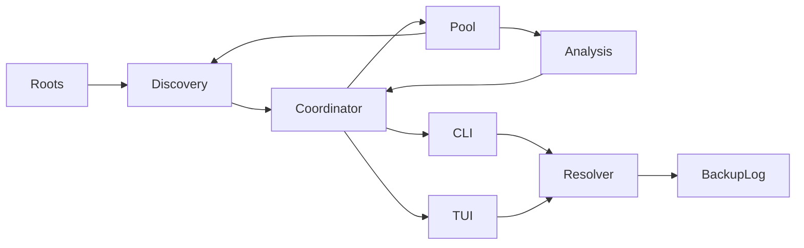

# Goals

### Direction
A complete Rust replacement, including a Rust TUI, is feasible and a good learning project. Prioritize reliability, then speed, while preserving or improving UX. Deliver incrementally with behavioral parity; preserve existing commands and outcomes rather than exact visual formatting. Benchmarking is supporting evidence, not a primary goal; avoid assuming speed gains.

### Compatibility and safety
Preserve conflict patterns and custom configuration, CLI and interactive workflows, media metadata and external tools, cache and decision-log behavior, and backup-first resolution. Keep user data safe, including on failures; dry-run must not write anywhere. Record existing discrepancies as explicit compatibility decisions rather than silently reproducing bugs.

### Scope
Implement the migration in the delivery order below. Work in `rust/`; the Python implementation is a frozen, read-only reference until parity is established — do not modify Python sources or tests, and do not modify sample data. Do not create a branch unless requested.

# Technical Design

### Existing baseline
`scan.py` walks roots serially and groups sorted paths; `engine.py` coordinates cache, analysis and resolution; `analyze.py` hashes and compares files; `resolve.py` backs up losers and logs decisions. `cli.py` and `tui/app.py` are separate frontends; `media.py`, `patterns.py`, `config.py`, and `launchers.py` contain substantial compatibility requirements. The referenced `.opencode/plans/2026-08-30-deconflict.md` is absent in this checkout.

### Rust architecture
Build a UI-free core with explicit discovery, grouping, analysis, cache, resolution and tool-launching boundaries, plus CLI and TUI frontends. Consider `clap` for CLI and `ratatui` with `crossterm` for TUI; validate dependency and platform fit before committing. Keep existing TOML and JSONL formats compatible, including regex features supported by existing custom patterns; investigate Python/Rust regex differences rather than assuming equivalence.

Ship the core as a Rust library consumed by a separate Rust CLI. Support the custom regex features needed in practice rather than blocking on complete Python regex parity; test Windows later. CLI progress should distinguish provisional findings from final results, keep machine-readable output usable, and never permit resolution after an incomplete scan.

Discovery feeds an in-memory coordinator; grouping and provisional analysis overlap further discovery. Use one shared worker pool for directory and analysis tasks, favoring analysis with fairness so discovery cannot starve. Finalize groups only once all relevant discovery is complete, including overlapping roots and symlink handling; provisional UI results cannot authorize destructive operations. Revalidate file identity and metadata before resolution, and serialize mutations and decision logging.

Expose documented configuration and CLI overrides for worker count, with conservative defaults and a one-worker mode. Respect existing `nice`/`ionice` inheritance on Linux; document external usage and portability rather than promising platform-independent I/O priority. Resource limits do not guarantee low CPU, memory, or disk impact; evaluate optional throttling only against measured need.

### Scheduling decision
Keep all pending directory and analysis tasks in memory without queue capacity limits; prioritize execution rather than delaying discovery to limit backlog. Do not reopen and rescan directories to control memory. Limit concurrent workers and open directory handles; memory grows with the number of tasks and results, assumed manageable for intended workloads. Measure performance rather than assuming an ideal priority policy.

### Risks
Filesystem changes during scanning, missing files, duplicate roots, ordering, case sensitivity, symlinks, errors and cache invalidation require explicit semantics. Maintain deterministic final ordering despite concurrency. Media parity, terminal behavior and Windows support may be harder than the core port. The current `Engine.scan()` refreshes cache even when dry-run is configured; verify and document this discrepancy against the stated no-write requirement.

# Validation

### Shared executable contract
Extend the existing `pytest` infrastructure with subprocess-based black-box tests parameterized by executable command: run against Python first, then the Rust binary. Use isolated temporary homes, config, cache, backup directories and copied fixtures; normalize paths and nondeterministic timestamps, while asserting exit codes, meaningful output and filesystem/log effects. Keep existing Typer-specific unit tests separately. Use PTY-based tests for representative interactive CLI/TUI flows; subprocess tests alone cannot establish TUI parity.

### Coverage and performance
Cover patterns/custom regex, grouping, multiple copies, missing bases, config, auto rules, dry-run no-write guarantees, backup/restore safety, decision logs, media/tool fallbacks and errors. Test one and multiple workers, randomized completion order, cancellation, overlapping roots, symlinks, permissions and files changing mid-scan. Use reproducible benchmarks when useful to assess performance, documenting workload and limitations; avoid hard speed claims or brittle CI timing thresholds.

# Delivery Steps

### ✓ Step 1: Establish behavioral and performance baselines
The Python implementation has an executable-level compatibility baseline.
- Inventory CLI, TUI, configuration, media, safety and platform behavior using existing tests and documentation.
- Add isolated subprocess-based `pytest` contract cases for Python, including dry-run and backup/log effects; record discrepancies without silently changing requirements.
- Define reproducible benchmark datasets and collect baseline measurements.

### ✓ Step 2: Build streaming Rust core
A UI-free Rust core discovers, groups and compares conflicts with bounded concurrency.
- Port patterns, configuration, traversal, grouping, hashing and analysis from the corresponding Python modules.
- Implement the shared fair scheduler, in-memory queues, provisional results and final grouping barrier with worker controls.
- Test deterministic output, concurrency limits, filesystem races and existing custom-pattern compatibility; use benchmarks where useful.

Status: 48 Rust tests pass; cancellation and disappearing-base errors are covered. ASCII regex support remains partial, Windows behavior unverified, and filesystem snapshots are not atomic. Media and mutation-time revalidation are deferred to step 3.

### ! Step 3: Port safe resolution and integrations — complete for core parity
The Rust core preserves resolution, cache and external-tool behavior safely.
- Port backup-first actions, dry-run, JSONL logging, cache, media metadata and tool discovery with compatible formats.
- Revalidate before changes and serialize filesystem mutations; handle cross-device moves and failures safely.
- Extend contract and fault-path tests against both executables.

Status: 61 Rust library tests pass. The 61-test library suite is green after the current cache/media API changes. Cancellation and disappearing-base errors are covered. ASCII regex support remains partial, Windows behavior unverified, and filesystem snapshots are not atomic. Media and cache APIs are implemented, but final CLI behavior and executable contracts still need validation.

**Current progress:**
- `resolve.rs` is exported as `deconflict_core::resolve`.
- Resolver unit and integration coverage includes dry-run, backup/log behavior, partial failures, symlinks, missing-scan rejection and changed-file rejection.
- Cache JSON loading, saving, keying, cleaning and dry-run protection are implemented in `cache.rs`.
- Added cache-aware and media-aware Rust group-analysis entry points in `analysis.rs`.
- `media.rs` now has a translated tool structure and content/metadata extraction APIs available to group analysis.
- Rust CLI scan/resolve code now passes cache and media configuration into analysis; `--no-cache` and `--refresh` surfaces are present.
- The release executable build started; shared executable-contract validation was not completed before stopping for today.

**Remaining Step 3 work:**
1. Validate cache reuse, refresh, no-cache and dry-run behavior against existing JSON/cache fixtures and executable contracts.
2. Correct/cache-test any media fields, kind detection or recommendation regressions found by contracts.
3. Persist/invalidate scan cache according to real resolve and dry-run semantics only after successful validation.
4. Close cross-device, recovery and interprocess-race gaps with fault-path tests.
5. Preserve JSONL and backup formats explicitly, documenting intentional compatibility decisions.

**CLI milestone completed:**
- Added a `clap`-based Rust executable named `deconflict` with `version`, `patterns`, `scan`, `resolve`, `init-config`, `setup`, `config` and `cache clean` surfaces.
- `scan`, `resolve --dry-run`, real resolution and backup decisions previously passed shared executable contracts.
- Fixed CLI pattern-name output and Python-compatible backup subdirectories/filenames.

**Verified next-step sequence:**
1. Finish cache/media wiring and run Rust plus shared executable contracts.
2. Close interprocess-race, cross-device and recovery gaps, then add executable-level resolution contracts.
3. Add real progress and bare interactive behavior, then the Ratatui TUI and PTY coverage.
4. Keep Python as the reference until Rust contracts pass; do not switch packaging or require Rust for existing users.

### ✓ Step 4: Finish CLI parity

**CLI parity status:**
- Restored the Rust CLI build and implemented setup/config/cache handlers.
- Root `--version`, root/bare command parsing, and scan/resolve option surfaces compile.
- Cache/media analysis entry points compile with the Rust library suite.
- `--no-cache` and `--refresh` are wired and have executable contract coverage.
- Real scan progress and a skipable bare CLI fallback are implemented.
- Rust interactive resolve reports per-group metadata, text differences, consideration notes and recommendations, then accepts the recommendation on Enter or base/copy/keep-both/skip/quit actions.
- Generic Rust metadata reports format created and modified timestamps separately, using Unix change time as the creation-time fallback.
- ExifTool metadata is parsed from JSON so MP3 fields and ID3 tags render with their real names and values. Tables highlight differences, newer/larger values, and recommendations with terminal-aware styling that is disabled for piped output or `NO_COLOR`.
- `--auto` remains noninteractive; `--tui` launches the Rust TUI described in Step 5.
- A copied `sample-files/` fixture smoke test found 9 conflict groups successfully.

**CLI completion sequence:**
1. ✓ Finish cache/media wiring and shared Python-vs-Rust executable contracts.
2. ✓ Fix contract failures and close executable-level resolution, dry-run and backup/log gaps.
3. ✓ Implement real CLI progress and bare interactive behavior; validate PTY flows where practical.
4. ✓ Run the full Rust suite, shared contracts and benchmark smoke checks.
5. ✓ Add CLI analysis-report parity and its executable contracts; commit the CLI milestone before further TUI work.

**Stable CLI gate:**
- A release build starts successfully on the target machine.
- Cache, refresh, no-cache and dry-run contracts pass for Python and Rust.
- Resolution, backup, JSONL and failure/recovery contracts pass.
- Existing CLI commands retain compatible options, exit codes and meaningful output.
- CLI resolution reports file metadata, content differences, considerations, recommendations, and interactive choices consistently with the Python CLI.
- Bare CLI behavior is usable; TTY invocation launches the Rust TUI, and `--no-tui` keeps the CLI fallback.
- The Rust test suite is green; frozen Python `mise run check` failures are tracked in Step 5.

**Current milestone — CLI report parity and Rust TUI implemented:**
- `main.rs` now only parses arguments and starts dispatch. CLI definitions, config helpers, progress, bare interactive mode, and scan/resolve commands live in focused modules.
- Successful scans save the file count in an optional `.count` sidecar; later scans reuse it as a progress estimate. `--no-cache`, dry-run resolution, and incomplete scans do not write estimates. Cache invalidation removes the sidecar.
- Progress labels distinguish files seen, the previous-run file estimate, directory entries discovered, and conflict copies queued/analyzed. ETA and overlapping discovery/analysis time windows are shown.
- Interactive progress uses two rows: timings and counters first, current path second; counts are compacted on narrower terminals. Unit tests cover the layout.
- `.github/instructions/rust.instructions.md` records Rust module boundaries, UI-free core rules, cache safety, test layout and quality gates.
- Architecture review: separate scan and resolve command modules add value because both implementations have distinct cache/progress/resolution workflows; keep the small remaining command handlers together.
- The Rust analysis core and CLI presentation are implemented; interactive reports include metadata, content differences, considerations, recommendations and actions. ExifTool JSON fields are preserved and styled tables honor terminal color support.
- Validation passed: Rust tests, Clippy with warnings denied, release build, shared executable contracts (7 passed, 1 skipped), and a copied `sample-files/` smoke scan (9 conflict groups).

**Follow-up complete:** restored full ExifTool metadata in Rust reports and added terminal-aware styling.

**Streaming interactive CLI — complete:**
- Directory-ready events now emit only after traversal and conflict-copy snapshots finish; failed/incomplete directories do not publish usable groups.
- Rich group analysis runs in a background worker while scanning continues. The CLI displays each analyzed group as soon as it is ready, with status updates while waiting for subsequent results.
- `resolve --wait-for-scan` delays interaction until discovery ends; `resolve --wait-for-analysis` waits for both discovery and all group reports. These flags are mutually exclusive and unavailable with `--auto`.
- User decisions are buffered until scanning and all group analyses succeed; an incomplete scan cannot mutate files, including choices already entered.
- Verified with Rust formatting, tests, Clippy, release build, and the Rust executable contract suite.

**Streaming CLI follow-up — complete:** progress redraws suspend while reports and prompts are displayed; “Choice recorded” and scan/analysis wait messages appear only when results are actually pending, and identical statuses are not repeated. On `q`, finish outstanding scan work quietly so prior choices remain eligible and the successful-scan estimate can still be saved. Validated by Rust unit/integration tests, Clippy, and a pseudo-terminal prompt/progress smoke test.

**Quit behavior — implemented:**
- `q` quits interaction but lets an active scan finish, preserving already recorded choices.
- `Q` cancels active scanning and queued group analysis, discards buffered choices, and does not persist a successful-scan estimate.
- Validated prompt case distinction, cancellation state, and executable behavior (no resolution or estimate on `Q`).

**Action milestone — complete in Rust:**
- Kept Python files and behavior unchanged; used the Python action matrix as a compatibility reference.
- Added UI-free action descriptors, per-kind availability, command construction, tool-mode classification, and text diff handling.
- Rust CLI presents clearer grouped choices, shows only available tool actions, reports relevant file-type/tool configuration, waits for launched tools, and re-analyzes groups after tools return.
- Added focused coverage for action availability, command arguments, tool modes, missing siblings, edit/re-analysis, and the existing `q`/`Q` cancellation behavior.
- Verified with formatting, all Rust tests, Clippy with warnings denied, and a release build.

**CLI refinements — complete:**
- Group reports show `Group x/y` (final total when known, discovered-so-far count otherwise) plus a one-time status snapshot for pending scan/analysis work; prompts are not redrawn while waiting for input.
- `(m) metadata` reprints the current group report.
- `(?) tools/config` lists each offered action with its exact external command, tool mode and configuration status for every file kind.
- The scan summary prints as soon as scanning finishes; timings subtract time spent at prompts.

**Analysis speed — complete:**
- Verified scan copy hashing is parallel with an analysis-favoring heuristic; rich group analysis is a separate FIFO thread and previously rehashed every copy. Interactive pipeline now passes scanner `FileInfo` snapshots to group analysis, validating size/mtime and re-hashing stale entries; copies are hashed once per scan.
- Scan/analysis still overlap across directories. There is no in-process OS priority; inherited `nice`/`ionice` remains the intended control. `--wait-for-*` changes prompt timing, not scheduling.

**Multi-copy reports — complete:**
- Added `sample_files/multi-three/` (3 files) and `sample_files/multi-four/` (4 files) outside the frozen `sample-files/` fixture used by Python contracts.
- Groups with 3+ files render one wide table when terminal width allows (headers wrap to 2–3 lines); narrow terminals keep the existing per-copy tables.

### ✓ Step 5: Rust TUI

**TUI migration — complete for core parity**
Status: Ratatui frontend is implemented on the existing scanner/analysis/resolve core. `resolve --tui` and bare TTY invocation launch it; `--no-tui` forces CLI fallback. Choices are buffered until scan/analysis complete; `q` finishes outstanding work, while `Q` cancels and writes nothing only while work is pending. Ctrl-C maps to the same interrupt. Python remains the read-only reference.
1. ✓ Reused scanner directory/group events; `tui::session::Session` streams findings and analysis, and `App` records choices for safe `finish()`.
   1. ✓ Main split is left / right, separator movable by mouse.
   2. ✓ Left side lists all groups found.
   3. ✓ Right side shows the selected group with detail tabs (`meta`, `files`, `diff`, `log`) and a file-detail pane; text files show the first 20 lines.
   4. ✓ Bottom action pane offers the available CLI actions as buttons.
   5. ✓ Bottom status rows reuse the CLI progress style.
2. ✓ Added seven PTY contracts in `rust/tests/tui.rs` for dry-run rendering, recorded skip, real keep-base resolution, forced cancel, Ctrl-C exit, quit with no groups and non-TTY rejection.
3. ✓ Validation: `cargo fmt`, `cargo check --all-targets`, `cargo clippy --all-targets -- -D warnings`, 133 Rust tests, release build, and shared executable contracts (7 passed, 1 skipped) are green.
4. Remaining: Windows terminal verification and frozen Python `mise run check` failures (for example, 11 vs 9 groups) are outside this milestone.

**Feedback follow-ups — complete**
- Final status row replaces the last scanned path with the shared `ScanProgress::summary` once scanning ends; live counters, elapsed time and ETA now come from shared `progress.rs` helpers used by both CLI and TUI.
- Force quit disappears from CLI and TUI prompts as soon as scanning and analysis finish; `q` remains available. With no groups, TUI still offers `q` and `Q` while work is pending, then only `q`.
- Group count moved to the top title row; the right pane has a visible bordered tab bar with mouse-selectable tabs. Action buttons, group rows, file rows and the separator remain mouse targets.
- Ctrl-C triggers force quit while work is pending and ordinary quit when all work is done.

**Progress/status refinements — complete**
- User requirements recorded 2026-11-27:
  - TUI `q` while scan/analysis is pending must show the same CLI progress bar as the CLI path until all work is done, unless progress is disabled.
  - Remove/collapse the third bottom status row; the last scanned path must not linger after completion.
  - `analysis x/y` must track rich group analysis, not provisional scanner copies; `14/14` must not appear while the left pane still shows analysis in progress.
  - Elapsed time must stop at scan+analysis completion in both CLI and TUI; time spent deciding is excluded.
  - The leading elapsed counter stays visible after completion and shows final time; `ready` is shown differently in the first row; decided/error counts move into the first row.
  - Record user-entered/decided requirements in the current plan; `AGENTS.md` now states this convention.
- Implementation: `TuiOptions.show_progress` propagates CLI `--progress`/`--no-progress`; TUI `q` with pending work leaves the alternate screen and refreshes the shared `ScanProgress` bar until scan + group analysis finish, then prints the summary.
- Implementation: `Session` freezes `final_elapsed`/`final_summary` at completion; status uses `group_analysis_counts()` and `final_progress_line()`; bottom pane is two rows with timing, phase, decided/error counters and a final summary instead of a lingering path.
- Implementation: CLI prints `ScanProgress::summary` once when the last group analysis lands, not after decisions.
- Validation: `cargo fmt --check`, `cargo check --all-targets`, `cargo clippy --all-targets -- -D warnings`, 135 Rust tests (including PTY), release build, and shared executable contracts (7 passed, 1 skipped) are green.

**Status wording, directory counts and error visibility — complete**
- User observations recorded 2026-11-27:
  - After scanning, row 1 showed `scan 28 files, 5 dirs, analysis 13/13` while row 2 showed `scan complete: 28 files, 6 dirs, 14 copies`; another scan differed by 4 dirs (5631 vs 5635).
  - Asked why the directory counters differ, what `14 copies` means, and requested row 2 show discovery and analysis times instead of redundant counts.
  - Requested consistent wording: the UI currently says `scan` for the discovery phase, while `scan complete` covers discovery + analysis.
  - Asked where errors are shown in CLI and TUI, including scan errors and errors hidden by `--no-progress`/TUI.
- Explanation: live `dirs` counted `Event::Directory` for discovered child directories before canonical dedupe and excluded seed roots; final `ScanResult.directory_count` counts unique canonical directories including roots. `copies` were provisional per-conflict analyses, not groups.
- Implementation: `Session::record` reconciles status files/dirs/queued copies with the authoritative `ScanResult`; status labels use `discovery` for file/dir enumeration and `analysis … groups` in TUI / `conflicts` in CLI.
- Implementation: TUI row 2 now shows `discovery …; analysis …; total …` instead of repeating counts; CLI summary says `conflict files` and keeps counts plus phase timings.
- Implementation: scan errors always print to CLI stderr, including with `--no-progress`; TUI records error messages and shows them in a new `errors` tab alongside group analysis failures, with the count in row 1.
- Validation: `cargo fmt --check`, `cargo check --all-targets`, `cargo clippy --all-targets -- -D warnings`, 137 Rust tests (including PTY), release build, and shared executable contracts (7 passed, 1 skipped) are green.

**Fine-tuning round — complete**
- User requirements recorded 2026-11-27:
  - `scan` is the whole command and includes `discovery` and `analysis` phases; generated CLI/TUI output should share wording and text.
  - User-facing wording says `conflicts`, not `groups`; users may not know what a group is.
  - Swap quit actions: `(q) quit` performs the current force-quit action; while scanning, `(Q) quit when scan is done` waits for completion. Use that wording.
  - ETA does not work, even after scanning the same directory repeatedly; fix or remove it.
  - Selected tab highlight is hard to see; improve it.
  - Add `press (h) to list keyboard shortcuts` in the second bottom row and explain all supported keys.
  - Hide tabs that have no content; start with `log` until a conflict is selected.
  - Improve mouse/keyboard responsiveness while scanning.
  - If supported (e.g. kitty graphics protocol), show scaled images side by side in the diff tab; otherwise fall back gracefully.
- Implementation: unified CLI/TUI analysis wording to `conflicts`; `progress::conflict_count` formats counts consistently; `scan` remains the full command with `discovery` and `analysis` phases.
- Implementation: swapped `(q)` and `(Q)` in prompts/actions/TUI; both remain available, `q` cancels pending work and `Q` waits; `Esc`/Ctrl-C interrupt.
- Implementation: removed unreliable ETA; progress shows elapsed time and phase counters only.
- Implementation: stronger selected-tab fill, `(h)` help tab with full key list, bottom hint row, dynamic tabs (log always; meta/files/diff only with selected conflict; errors only with failures; help always), initial log tab.
- Implementation: event loop waits briefly for input, drains queued events, then polls workers without blocking; inline image pairs use kitty graphics protocol when advertised and fall back to text.
- Compatibility: frozen `scan` executable contract still expects `1 conflict group(s)`, so the scan summary emits the user-facing `1 conflict` line plus a legacy alias line; Python tests stay untouched.
- Validation: `cargo fmt --check`, `cargo check --all-targets`, `cargo clippy --all-targets -- -D warnings`, 140 Rust tests (including PTY), release build, and shared executable contracts (7 passed, 1 skipped) are green.

**Next feedback round — complete**
- User feedback recorded 2026-11-27:
  - Mouse tab clicks are off by one for `diff` → `log`; hit-test widths do not match rendered tab widths.
  - Done progress row shows `00:00:09` while `discovery 0.1s`, `analysis 0.8s`, `total 9.5s`; investigate unaccounted time, likely prompt/user-input waiting included in phase timings.
  - Hide `(Q) quit when scan is done` once scan and analysis are complete.
  - Inline images currently overlap panes and are blurry; remove automatic overlay and make image viewing an explicit action that uses a tab.
  - `(v)` audio view currently plays both tracks at once; mpv cannot be controlled and writes stray terminal output.
  - Scan for GUI audio players and offer one as the GUI audio action when available.
  - View actions should target one file: TUI single-file actions only from the `files` tab for the selected file; CLI should ask which file to view, with `b` for both where supported and not for audio.
  - Resolution messages such as `moved: …` leak into TUI mode without newlines.
  - Prepare branch for Rust as main project: move Python to a subdirectory, normalize Rust layout/workflows including publishing, update README, and switch version to 0.3.0 with a `rust rewrite` changelog entry.
- Result:
  - Tabs now pad labels to a common width and use the same widths for hit-testing; timing breakdown adds an explicit `waiting` segment.
  - `Q` is hidden from action lists/help once work is complete but still accepted as a shortcut; `q` remains immediate quit.
  - Images use an explicit `images` tab with kitty output confined to that pane and Lanczos scaling; no automatic overlay on `diff`.
  - View/edit commands accept a selected file from the TUI `files` tab; CLI asks for a file and supports `b` for both except audio. Audio opens one file, prefers GUI players, and GUI launches discard stdout/stderr.
  - TUI summary suppresses per-file `moved:`/`would move:` lines and prints remaining summary with CRLF.
  - Rust moved to repo root as version 0.3.0; Python reference and fixtures moved under `python/`; README/AGENTS/CI/publish workflows updated for Rust-first publishing.
  - Validation: `cargo fmt --all`, `cargo check --all-targets`, `cargo clippy --all-targets -- -D warnings`, 143 Rust tests (including PTY), release build, and frozen executable contract against `target/release/deconflict` (7 passed, 1 skipped) are green.
  - Frozen Python suite remains non-gating: `test_cli.py`/`test_engine.py`/`test_scan.py` diverge from expanded sample fixtures; Python sources/tests were not modified. CI keeps the suite as a signal and gates on Rust checks plus the shared executable contract.

**Latest feedback round — done**
- User feedback recorded 2026-11-27:
  - Document how `waiting` time is counted in README near the end.
  - Colors in the meta diff table are lost; restore them and reuse the same colors in the `files` tab table.
  - `?` no longer shows the command/help list.
  - In the `files` tab, selected-file details should also show diff / newer / older like the meta table.
  - Done: README `## Timing breakdown` documents `waiting = total - max(discovery, analysis)` and excluded CLI prompt pauses.
  - Done: `CellTone` is shared between report and TUI; `ansi_line` renders metadata-table colors again; `files` table uses the same tones for size/mtime differences.
  - Done: `?` always opens the command list and `config_help` works without a selected/analyzed conflict.
  - Done: `files` tab detail header shows content/size/modified relations; unit + PTY tests added.
  - Validation: fmt, clippy, all Rust tests (76 lib + 27 binary + 34 integration + 10 PTY), release build and frozen executable contract (7 passed, 1 skipped) green.

**Files-tab readability feedback — done**
- User feedback recorded 2026-11-27:
  - `files` tab `size` column is too narrow to show the diff annotation.
  - Colors in the selected file row/column are hard to read.
  - Done: `files` size column widened from 20 to 26 columns so `(↑ 19 B)`/`(↓ …)` diffs fit; PTY contract asserts the full annotation.
  - Done: selected cells use dark-gray background with readable foreground (white for untinted cells), no DIM modifier; `NO_COLOR` stays bold-only.
  - Done: unit test covers selected-cell contrast.
  - `sample-files/` kept at repo root by user decision; Rust media test updated to the root path. Python tests still pointing at `python/sample-files` are part of the reference to retire.
  - Validation: fmt, clippy, all Rust tests (76 lib + 28 binary + 34 integration + 10 PTY), release build and frozen executable contract (7 passed, 1 skipped) green.

**Auto-focus feedback — done**
- User feedback recorded 2026-11-27:
  - Start on `log`, then switch to `meta` as soon as the first conflict group appears; do not override tab choices after that.
  - Done: `App::auto_focus_first_group` switches once on the first group; unit + PTY coverage added.
  - Validation: fmt, clippy, all Rust tests (76 lib + 29 binary + 34 integration + 10 PTY), release build green.

**Architecture principles:**
- `main.rs` is process startup and dispatch only.
- Core modules remain UI-free and reusable.
- Config, commands and progress are separate concerns with explicit interfaces.
- Tests for public behavior belong in `tests/`; private unit tests stay beside implementation.
